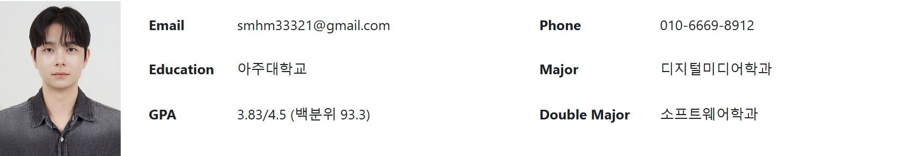
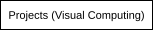
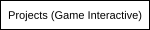
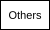
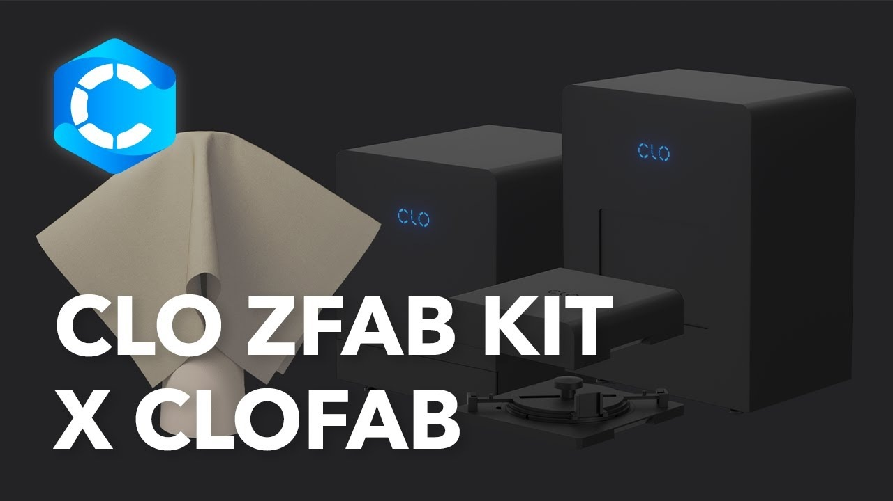
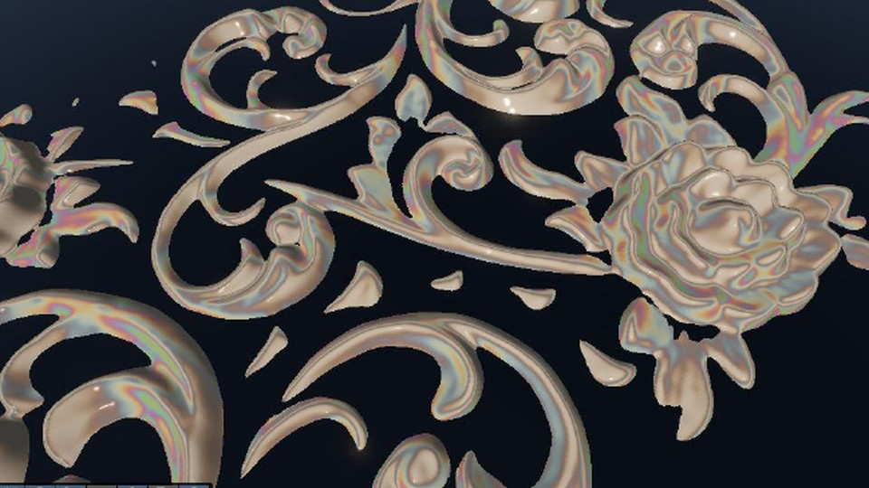
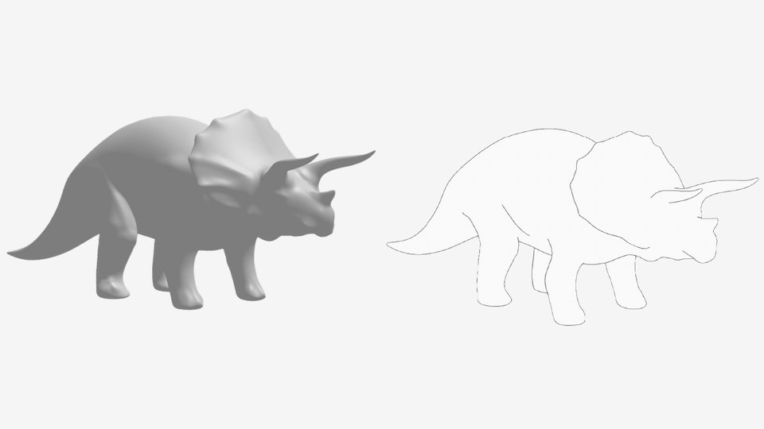
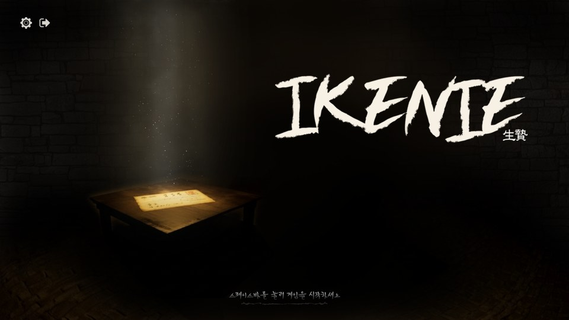
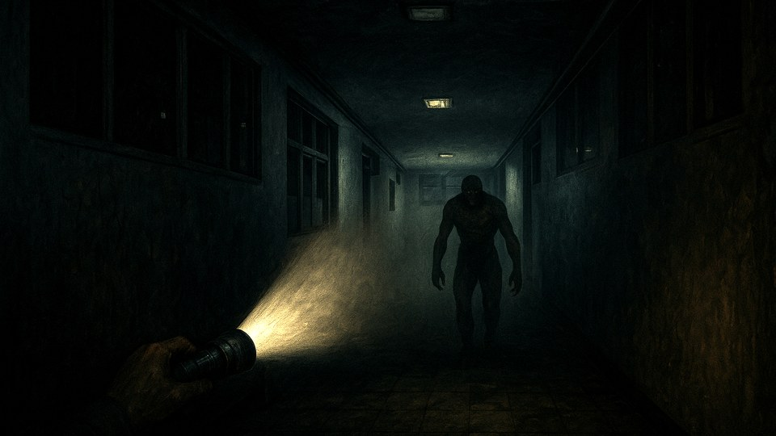

# 서문현모 | Software Engineer

## Personal Information

## Work experience

<table width="100%">
<tr>
<td width="100%" valign="top">

<h3><a href="https://github.com/HyunmoSeomoon/Internship-at-CLO">R&amp;D Software Engineer Intern at CLO Virtual Fashion</a></h3>

<code>C++</code> <code>OpenCV</code> <code>Claude Code</code> 2026.07 - 2026.08 · R&amp;D 소프트웨어 엔지니어 인턴

타일 경계의 색·명암과 무늬 위상 문제를 나눠 보정 파이프라인을 개선했습니다. 국소 잡음 복원과 텍스처 편집 기능 3종을 개발하고, 비교 자동화와 사용자 부서 피드백을 통해 결과를 확인했습니다.

<strong>116개 샘플 중 84개 개선 판정</strong> · 신규 기능 3종 개발 내부 코드와 실제 샘플은 공개하지 않습니다. <a href="https://github.com/HyunmoSeomoon/Internship-at-CLO">프로젝트 저장소 →</a>

</td>
</tr>
</table>

## Projects (Visual Computing)

<table width="100%">
<tr>
<td width="50%" valign="top">

<h3><a href="https://github.com/Ramin0815/Korea_Traditional_Material_Shader">한국 전통 소재의 재질 셰이더</a></h3>

<code>Unity 6 URP</code> <code>HLSL</code> <code>OpenGL</code> 2025.09 - 2025.12 · 2인 팀 · 그래픽스 프로그래머

자개 간섭색 계산을 17개 파장으로 확장하고, 갓의 곡면에 맞는 엮임·테두리 표현을 구현했습니다. C++·OpenGL·Dear ImGui 기반 디버깅 렌더러를 제작해 재질 파라미터를 조정했습니다.

<strong>2025 교내 미디어데이 우수작 선정</strong> <a href="https://github.com/Ramin0815/Korea_Traditional_Material_Shader">프로젝트 저장소 →</a>

</td>
<td width="50%" valign="top">

<h3><a href="https://github.com/HyunmoSeomoon/Contour-Rendering">Contour Rendering</a></h3>

<code>C++</code> <code>OpenGL</code> <code>GLSL</code> <code>Geometry Shader</code> 개인 프로젝트 · 렌더링 파이프라인·셰이더 구현

GPU 프로그래밍 과제를 확장해 화면상 외곽선 두께를 일정하게 표현했습니다. 후처리 quad의 좌표 변환 오류를 수정하고, depth pre-pass와 깊이 비교로 가려진 뒷면 외곽선을 제거했습니다.

<strong>기본 과제를 확장한 렌더링 구현·오류 분석</strong> <a href="https://github.com/HyunmoSeomoon/Contour-Rendering">프로젝트 저장소 →</a>

</td>
</tr>
</table>

## Projects (Game Interactive)

<table width="100%">
<tr>
<td width="50%" valign="top">

<h3><a href="https://github.com/HyunmoSeomoon/Project-Paran">IKENIE</a></h3>

<code>Unity 6</code> <code>C#</code> <code>Cinemachine</code> <code>NavMeshAgent</code> 2025.09 - 2025.12 · 6인 팀 · 팀장 / 클라이언트 프로그래머

3D TPS 잠입 액션 게임에서 플레이어·카메라, 시야·청각 기반 적 FSM, 분기 컷씬 전환을 구현했습니다. 행동 우선순위와 공동 수색 구역 할당을 설계하고, 팀 작업과 피드백 반영을 조율했습니다.

<strong>2025 교내 미디어데이 우수작 선정 · GGC 전시</strong> <a href="https://github.com/HyunmoSeomoon/Project-Paran">프로젝트 저장소 →</a> · <a href="https://www.youtube.com/watch?v=htIDy72hus0">소개 영상 ↗</a>

</td>
<td width="50%" valign="top">

<h3><a href="https://github.com/HyunmoSeomoon/Only-the-Light">Only the Light</a></h3>

<code>Unity 6</code> <code>C#</code>

프로젝트 상세 소개는 추후 추가할 예정입니다.

<a href="https://github.com/HyunmoSeomoon/Only-the-Light">프로젝트 저장소 →</a>

</td>
</tr>
</table>

## Activities

- **게임 개발 소학회 TML 회장** · 2025.03 - 2026.02  
  소학회 운영, 게임 제작 활동과 홍보 콘텐츠 기획·개발, Unity 6 스터디를 진행했습니다.
- **Unity 6 스터디 운영·강의** · 2025  
  강의·과제·튜토리얼 FPS를 제작하고 채점을 진행했습니다. 수강 인원 60명 중 약 47명이 최종 과제를 완료했습니다.
- **Python 데이터 분석 교육 튜터** · 2024.05  
  고등학생 대상 Pandas·Matplotlib 강의자료를 제작하고 수업을 진행했습니다. 자료는 동아리에 기증해 재사용할 수 있도록 했습니다.
- **U-CHANGE FAIR 전공 멘토** · 2025.04  
  학과 트랙·교육과정을 소개하고 저학년 학생의 전공·진로 상담을 진행했습니다.

## Course work

수업에서 직접 구현하거나 실험한 내용을 중심으로 정리했습니다.

| 분야 | 관련 교과목 | 주요 구현·실험 |
| --- | --- | --- |
| 렌더링 | 컴퓨터그래픽스 · GPU프로그래밍 | OpenGL 변환·조명·텍스처·범프 매핑, FBO 기반 멀티패스, Geometry Shader, 파티클·Transform Feedback |
| 영상처리·비전 | 영상처리 · 컴퓨터비전 | 필터·영상 복원·Skeleton 추출, Multiband blending, Hough Circle 검출, 특징점·homography 기반 Image Stitching |
| 애니메이션 | 애니메이션이론 | Catmull-Rom Spline, BVH 모션 재생, Cloth 시뮬레이션 |
| 기계학습 | 기계학습 | 분류·회귀 모델 비교, PyTorch 학습·평가 루프, MobileNet 기반 모델·ConvMixer 구성, 데이터 증강·앙상블 추론 |
| 게임·인터랙션 | 게임엔진프로그래밍 · 메타버스프로그래밍 | Unity 게임 제작, 적 감지·행동 제어, AR·상호작용 콘텐츠 제작 |
| 컴퓨터과학 기초 | 자료구조 · 알고리즘 · 운영체제 · 컴퓨터구조 · 컴퓨터네트워크 · 선형대수 | 자료구조·알고리즘, 시스템·네트워크, 그래픽스와 학습 모델의 수학적 기반 학습 |

## Technical Stacks

| 구분 | 프로젝트에서 사용한 기술 |
| --- | --- |
| 언어 | C++ · C# · Python · C · GLSL · HLSL |
| 렌더링·영상처리 | OpenGL · OpenCV · Dear ImGui |
| 게임·실감 콘텐츠 | Unity 6 · URP · Cinemachine · NavMeshAgent · Unreal Engine 5 Blueprint |
| 기계학습·데이터 | PyTorch · torchvision · scikit-learn · LightGBM · NumPy · pandas · Matplotlib · Google Colab |
| 개발·협업 | Git · GitHub · Slack · Notion · Claude Code |

## Others

| 프로젝트 | 사용 기술 | 본인 구현·담당 |
| --- | --- | --- |
| **기계학습 모델 학습·비교** | Python · PyTorch · scikit-learn | 이미지 분류 모델의 학습·추론 구성, 파라미터 수 제약에 따른 모델 후보 선택, 분류·회귀 실험 |
| **아주고침** | Unreal Engine 5 Blueprint · Android | 이미지 마커 기반 AR 모델 생성, 다중 이미지 인식, Android 패키징·디버깅 |
| **TML Shooter** | Unity 6 · C# | Unity 스터디 과제용 FPS 게임과 사격·적 행동 구현 |
| **말리지마** | Unity 6 · Git | 소학회 홍보용 가상 경마 콘텐츠의 기획·중심 로직 설계 |
