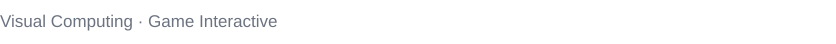
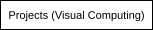
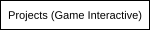
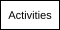
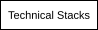
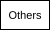
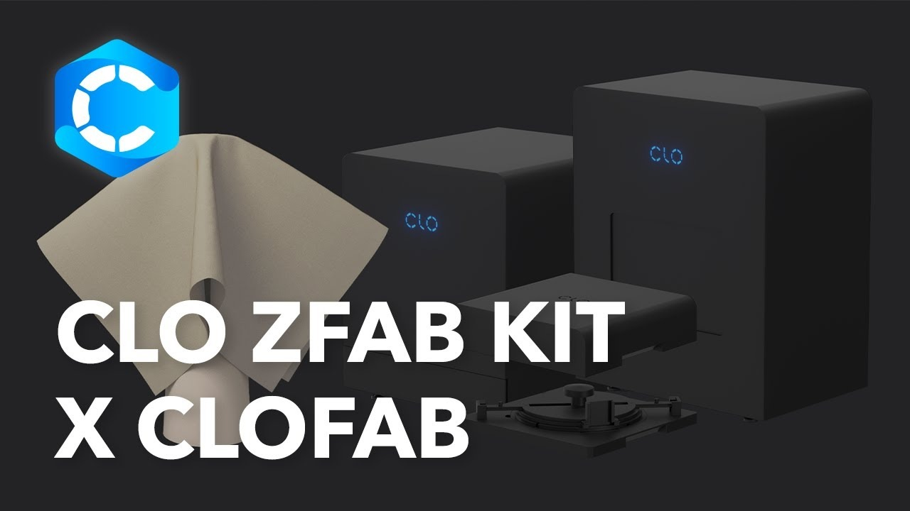
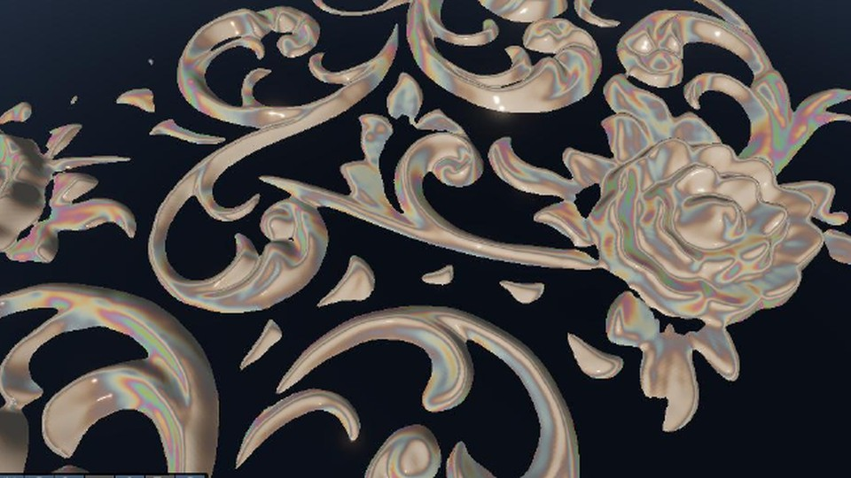
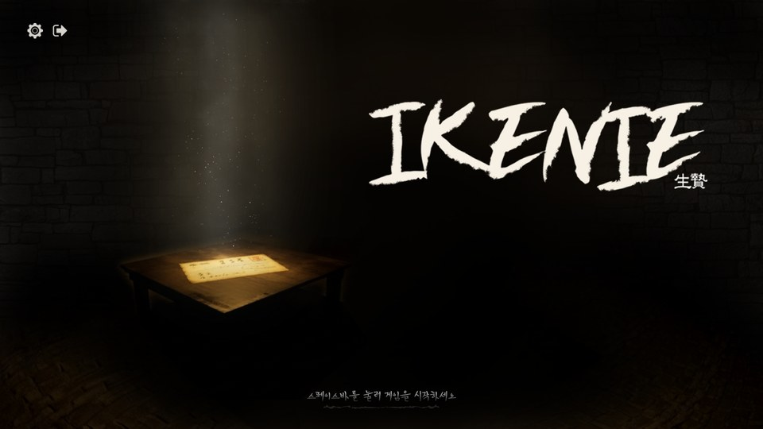
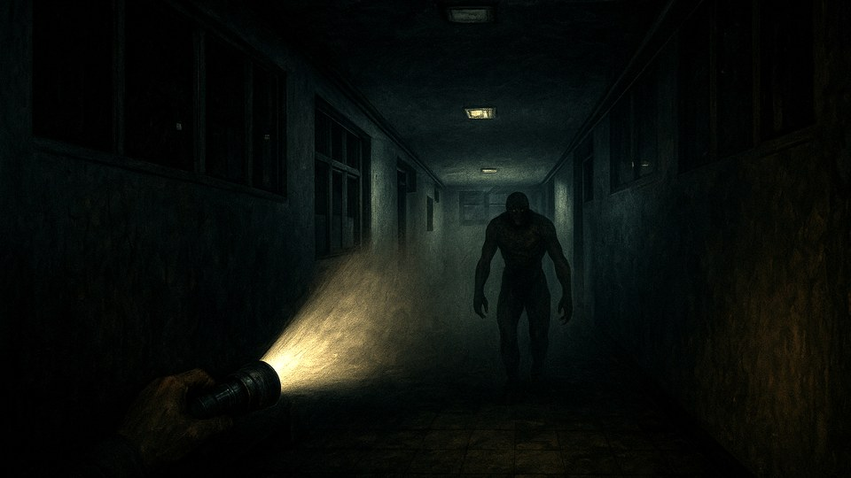

# 서문현모 | Software Engineer

## Personal Information

## Work experience

<table width="100%">
<tr>
<td width="100%" valign="top">

<h3><a href="https://github.com/HyunmoSeomoon/Internship-at-CLO">zFab Scanning Image Post-processing</a></h3>

<code>C++</code> <code>OpenCV</code> <code>Claude Code</code>

<table width="100%">
<tr><th align="left" scope="row">Type</th><td>Industry <strong>(CLO Virtual Fashion)</strong></td></tr>
<tr><th align="left" scope="row">Member</th><td>6</td></tr>
<tr><th align="left" scope="row">Position</th><td>Software Engineer</td></tr>
<tr><th align="left" scope="row">Core Work</th><td>CLOFAB 원단 텍스처 처리 개선</td></tr>
</table>
</td>
</tr>
</table>

## Projects (Visual Computing)

<table width="100%">
<tr>
<td width="50%" valign="top">

<h3><a href="https://github.com/Ramin0815/Korea_Traditional_Material_Shader">한국 전통 소재 머티리얼 제작</a></h3>

<code>Unity 6 URP</code> <code>HLSL</code> <code>C++</code> <code>OpenGL</code>

<table width="100%">
<tr><th align="left" scope="row">Type</th><td>Personal</td></tr>
<tr><th align="left" scope="row">Member</th><td>2</td></tr>
<tr><th align="left" scope="row">Position</th><td>Graphics Engineer</td></tr>
<tr><th align="left" scope="row">Core Work</th><td>갓·자개 재질 셰이더 및 디버깅 렌더러 구현</td></tr>
</table>
</td>
<td width="50%" valign="top">

<h3><a href="https://github.com/HyunmoSeomoon/Contour-Rendering">Contour Rendering</a></h3>

<code>C++</code> <code>OpenGL</code> <code>GLSL</code>

<table width="100%">
<tr><th align="left" scope="row">Type</th><td>Personal</td></tr>
<tr><th align="left" scope="row">Member</th><td>1</td></tr>
<tr><th align="left" scope="row">Position</th><td>Graphics Engineer</td></tr>
<tr><th align="left" scope="row">Core Work</th><td>화면상 두께가 일정한 외곽선 렌더링 구현</td></tr>
</table>
</td>
</tr>
</table>

## Projects (Game Interactive)

<table width="100%">
<tr>
<td width="50%" valign="top">

<h3><a href="https://github.com/HyunmoSeomoon/Project-Paran">IKENIE</a></h3>

<code>Unity 6</code> <code>C#</code> <code>Cinemachine</code> <code>NavMeshAgent</code>

<table width="100%">
<tr><th align="left" scope="row">Type</th><td>Personal</td></tr>
<tr><th align="left" scope="row">Member</th><td>6</td></tr>
<tr><th align="left" scope="row">Position</th><td>Team Lead / Client Programmer</td></tr>
<tr><th align="left" scope="row">Core Work</th><td>잠입 액션 게임의 플레이어·카메라, 적 FSM, 분기 컷씬 구현</td></tr>
</table>
</td>
<td width="50%" valign="top">

<h3><a href="https://github.com/HyunmoSeomoon/Only-the-Light">Only the Light</a></h3>

<code>Unity 6</code> <code>C#</code>

<table width="100%">
<tr><th align="left" scope="row">Type</th><td>Personal</td></tr>
<tr><th align="left" scope="row">Member</th><td>4</td></tr>
<tr><th align="left" scope="row">Position</th><td>Team Lead / Gameplay Programmer</td></tr>
<tr><th align="left" scope="row">Core Work</th><td>공포 액션 게임의 손전등 시스템 설계 및 적 감지·플레이어 이동 구현</td></tr>
</table>
</td>
</tr>
<tr>
<td width="50%" valign="top">
<h3>암행어스</h3>

<code>Roblox Studio</code>

<table width="100%">
<tr><th align="left" scope="row">Type</th><td>Coursework</td></tr>
<tr><th align="left" scope="row">Member</th><td>2</td></tr>
<tr><th align="left" scope="row">Position</th><td>Team Lead / Game Designer / Developer</td></tr>
<tr><th align="left" scope="row">Core Work</th><td>Roblox 기반 멀티플레이어 추리 게임 기획 및 개발</td></tr>
</table>
</td>
<td width="50%" valign="top">
<h3>Pest Runner</h3>

<code>Unity 6</code> <code>AR</code>

<table width="100%">
<tr><th align="left" scope="row">Type</th><td>Coursework</td></tr>
<tr><th align="left" scope="row">Member</th><td>2</td></tr>
<tr><th align="left" scope="row">Position</th><td>Team Lead / Game Designer / Developer</td></tr>
<tr><th align="left" scope="row">Core Work</th><td>AR 러닝 게임의 벌레 생성·추적 및 메달 지급·저장 구현</td></tr>
</table>
</td>
</tr>
</table>

## Activities

- **게임 개발 소학회 TML 회장** · 2025.03 - 2026.02  
  소학회 운영, 게임 제작 활동과 홍보 콘텐츠 기획·개발, Unity 6 스터디를 진행했습니다.
- **Unity 6 스터디 운영·강의** · 2025  
  강의·과제·튜토리얼 FPS를 제작하고 채점을 진행했습니다. 수강 인원 60명 중 약 47명이 최종 과제를 완료했습니다.
- **Python 데이터 분석 교육 튜터** · 2024.05  
  고등학생 대상 Pandas·Matplotlib 강의자료를 제작하고 수업을 진행했습니다. 자료는 동아리에 기증해 재사용할 수 있도록 했습니다.
- **U-CHANGE FAIR 전공 멘토** · 2025.04  
  학과 트랙·교육과정을 소개하고 저학년 학생의 전공·진로 상담을 진행했습니다.

## Course work

수업에서 직접 구현하거나 실험한 내용을 중심으로 정리했습니다.

| 분야 | 관련 교과목 | 주요 구현·실험 |
| --- | --- | --- |
| 렌더링 | 컴퓨터그래픽스 · GPU프로그래밍 | OpenGL 변환·조명·텍스처·범프 매핑, FBO 기반 멀티패스, Geometry Shader, 파티클·Transform Feedback |
| 영상처리·비전 | 영상처리 · 컴퓨터비전 | 필터·영상 복원·Skeleton 추출, Multiband blending, Hough Circle 검출, 특징점·homography 기반 Image Stitching |
| 애니메이션 | 애니메이션이론 | Catmull-Rom Spline, BVH 모션 재생, Cloth 시뮬레이션 |
| 기계학습 | 기계학습 | 분류·회귀 모델 비교, PyTorch 학습·평가 루프, MobileNet 기반 모델·ConvMixer 구성, 데이터 증강·앙상블 추론 |
| 게임·인터랙션 | 게임엔진프로그래밍 · 메타버스프로그래밍 | Unity 게임 제작, 적 감지·행동 제어, AR·상호작용 콘텐츠 제작 |
| 컴퓨터과학 기초 | 자료구조 · 알고리즘 · 운영체제 · 컴퓨터구조 · 컴퓨터네트워크 · 선형대수 | 자료구조·알고리즘, 시스템·네트워크, 그래픽스와 학습 모델의 수학적 기반 학습 |

## Technical Stacks

| 구분 | 프로젝트에서 사용한 기술 |
| --- | --- |
| 언어 | C++ · C# · Python · C · GLSL · HLSL |
| 렌더링·영상처리 | OpenGL · OpenCV · Dear ImGui |
| 게임·실감 콘텐츠 | Unity 6 · URP · Cinemachine · NavMeshAgent · Unreal Engine 5 Blueprint |
| 기계학습·데이터 | PyTorch · torchvision · scikit-learn · LightGBM · NumPy · pandas · Matplotlib · Google Colab |
| 개발·협업 | Git · GitHub · Slack · Notion · Claude Code |

## Others

<table width="100%">
<tr>
<td width="50%" valign="top">
<h3>CNN Image Classification</h3>

<code>Python</code> <code>PyTorch</code>

<table width="100%">
<tr><th align="left" scope="row">Type</th><td>Personal</td></tr>
<tr><th align="left" scope="row">Member</th><td>1</td></tr>
<tr><th align="left" scope="row">Position</th><td>ML Developer</td></tr>
<tr><th align="left" scope="row">Core Work</th><td>Tiny ImageNet 분류용 경량 CNN 학습 및 앙상블 추론</td></tr>
</table>
</td>
<td width="50%" valign="top">
<h3>아주고침</h3>

<code>Unreal Engine 5</code> <code>Blueprint</code> <code>Android</code>

<table width="100%">
<tr><th align="left" scope="row">Type</th><td>Personal</td></tr>
<tr><th align="left" scope="row">Member</th><td>2</td></tr>
<tr><th align="left" scope="row">Position</th><td>Team Lead / AR Developer</td></tr>
<tr><th align="left" scope="row">Core Work</th><td>이미지 마커 기반 3D AR 렌더링 및 Android 패키징</td></tr>
</table>
</td>
</tr>
<tr>
<td width="50%" valign="top">
<h3>TML Shooter</h3>

<code>Unity 6</code> <code>C#</code>

<table width="100%">
<tr><th align="left" scope="row">Type</th><td>Personal</td></tr>
<tr><th align="left" scope="row">Member</th><td>1</td></tr>
<tr><th align="left" scope="row">Position</th><td>Gameplay Programmer</td></tr>
<tr><th align="left" scope="row">Core Work</th><td>Unity 스터디용 FPS의 사격 및 적 행동 구현</td></tr>
</table>
</td>
<td width="50%" valign="top">
<h3>말리지마</h3>

<code>Unity 6</code> <code>Git</code>

<table width="100%">
<tr><th align="left" scope="row">Type</th><td>Club</td></tr>
<tr><th align="left" scope="row">Member</th><td>2</td></tr>
<tr><th align="left" scope="row">Position</th><td>Game Designer</td></tr>
<tr><th align="left" scope="row">Core Work</th><td>소학회 홍보용 가상 경마 콘텐츠 기획 및 시뮬레이션 로직 설계</td></tr>
</table>
</td>
</tr>
</table>
