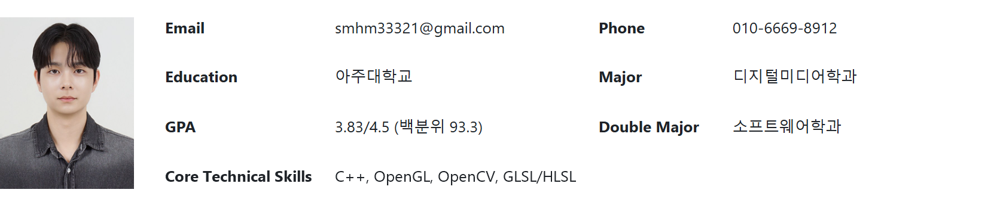
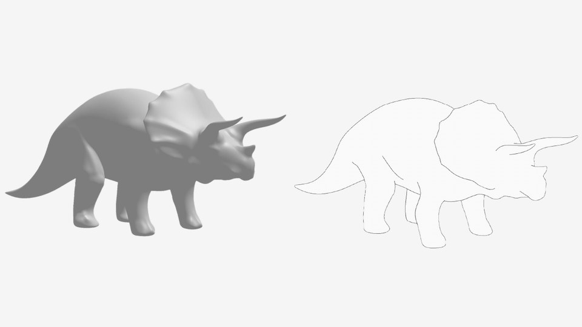
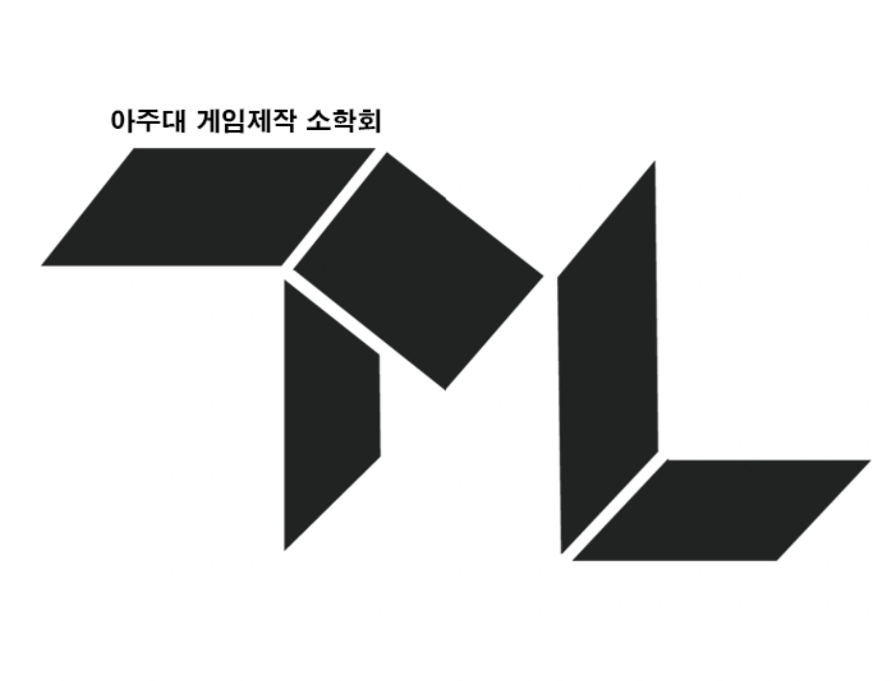

# 서문현모 | Graphics Software Engineer 

## Personal Information

## Work experience

<table width="100%">
<tr>
<td colspan="2">

<h3><a href="https://github.com/HyunmoSeomoon/Internship-at-CLO">zFab Scanning Image Post-processing</a></h3>

<code>C++</code> <code>OpenCV</code> <code>Claude Code</code>

</td>
</tr>
<tr><th width="24%" align="left" scope="row">Type</th><td>Industry <strong>(CLO Virtual Fashion)</strong></td></tr>
<tr><th align="left" scope="row">Member</th><td>6</td></tr>
<tr><th align="left" scope="row">Position</th><td>Software Engineer</td></tr>
<tr><th align="left" scope="row">Core Work</th><td>CLOFAB Auto-Tiling 기능 개선, 클라이언트 요청 기능 3종 추가 구현</td></tr>
</table>

## Projects (Visual Computing)

<!-- Two 410px cards leave room for a classic scrollbar. The narrow picture source lets a single card fill the row. -->

<table align="left">
<tr>
<td colspan="2">
<a href="https://github.com/Ramin0815/Korea_Traditional_Material_Shader"><picture>
<source media="(width &lt; 1280px)" srcset="assets/projects/materials.jpg 960w">
<source srcset="assets/projects/materials.jpg 2.513089006x">

</picture></a>

<strong><a href="https://github.com/Ramin0815/Korea_Traditional_Material_Shader">한국 전통 소재 머티리얼 제작</a></strong>

<code>Unity 6 URP</code> <code>HLSL</code> <code>C++</code> <code>OpenGL</code>

</td>
</tr>
<tr><th align="left" scope="row" valign="top">Type</th><td valign="top">Personal</td></tr>
<tr><th align="left" scope="row" valign="top">Member</th><td valign="top">2</td></tr>
<tr><th align="left" scope="row" valign="top">Position</th><td valign="top">Graphics Engineer</td></tr>
<tr><th align="left" scope="row" valign="top">Core Work</th><td valign="top">갓·자개 셰이더 및 디버깅 렌더러 구현</td></tr>
</table>
<table align="right">
<tr>
<td colspan="2">
<a href="https://github.com/HyunmoSeomoon/Contour-Rendering"><picture>
<source media="(width &lt; 1280px)" srcset="assets/projects/contour.jpg 960w">
<source srcset="assets/projects/contour.jpg 2.513089006x">

</picture></a>

<strong><a href="https://github.com/HyunmoSeomoon/Contour-Rendering">Contour Rendering</a></strong>

<code>C++</code> <code>OpenGL</code> <code>GLSL</code>

</td>
</tr>
<tr><th align="left" scope="row" valign="top">Type</th><td valign="top">Personal</td></tr>
<tr><th align="left" scope="row" valign="top">Member</th><td valign="top">1</td></tr>
<tr><th align="left" scope="row" valign="top">Position</th><td valign="top">Graphics Engineer</td></tr>
<tr><th align="left" scope="row" valign="top">Core Work</th><td valign="top">일정한 두께의 외곽선 렌더링</td></tr>
</table>
 

## Projects (Game Interactive)

<table align="left">
<tr>
<td colspan="2">
<a href="https://github.com/HyunmoSeomoon/Project-Paran"><picture>
<source media="(width &lt; 1280px)" srcset="assets/projects/ikenie.jpg 960w">
<source srcset="assets/projects/ikenie.jpg 2.513089006x">

</picture></a>

<strong><a href="https://github.com/HyunmoSeomoon/Project-Paran">IKENIE</a></strong>

<code>Unity 6</code> <code>C#</code> <code>Cinemachine</code> <code>NavMeshAgent</code>

</td>
</tr>
<tr><th align="left" scope="row" valign="top">Type</th><td valign="top">Personal</td></tr>
<tr><th align="left" scope="row" valign="top">Member</th><td valign="top">6</td></tr>
<tr><th align="left" scope="row" valign="top">Position</th><td valign="top">Team Lead / Client Programmer</td></tr>
<tr><th align="left" scope="row" valign="top">Core Work</th><td valign="top">플레이어·카메라, 적 FSM 및 컷씬 분기 구현</td></tr>
</table>
<table align="right">
<tr>
<td colspan="2">
<a href="https://github.com/HyunmoSeomoon/Only-the-Light"><picture>
<source media="(width &lt; 1280px)" srcset="assets/projects/only-the-light.jpg 960w">
<source srcset="assets/projects/only-the-light.jpg 2.513089006x">

</picture></a>

<strong><a href="https://github.com/HyunmoSeomoon/Only-the-Light">Only the Light</a></strong>

<code>Unity 6</code> <code>C#</code>

</td>
</tr>
<tr><th align="left" scope="row" valign="top">Type</th><td valign="top">Personal</td></tr>
<tr><th align="left" scope="row" valign="top">Member</th><td valign="top">4</td></tr>
<tr><th align="left" scope="row" valign="top">Position</th><td valign="top">Team Lead / Gameplay Programmer</td></tr>
<tr><th align="left" scope="row" valign="top">Core Work</th><td valign="top">손전등 설계, 적 감지와 플레이어 이동 구현</td></tr>
</table>
 

<table align="left">
<tr>
<td colspan="2">
<a href="https://github.com/HyunmoSeomoon/operate-TML"><picture>
<source media="(width &lt; 1280px)" srcset="assets/projects/tml.png 1440w">
<source srcset="assets/projects/tml.png 3.769633508x">

</picture></a>

<strong><a href="https://github.com/HyunmoSeomoon/operate-TML">교내 게임 개발 소학회 TML 운영</a></strong>

<code>Unity 6</code> <code>C#</code> <code>Codex</code>

</td>
</tr>
<tr><th align="left" scope="row" valign="top">Type</th><td valign="top">Club</td></tr>
<tr><th align="left" scope="row" valign="top">Impact</th><td valign="top">부스 참여 <strong>207명</strong> · 회원 <strong>28 → 69명</strong></td></tr>
<tr><th align="left" scope="row" valign="top">Position</th><td valign="top">Club President</td></tr>
<tr><th align="left" scope="row" valign="top">Core Work</th><td valign="top">소학회 운영, Unity 6 스터디 기획·강의, 게임 및 운영 보조 도구 제작</td></tr>
</table>
 

## Other Activities

- **암행어스** · 2인 교과 프로젝트 팀장 · Roblox Studio 기반 멀티플레이어 추리 게임 기획 및 개발
- **Pest Runner** · 2인 교과 프로젝트 팀장 · Unity 6 기반 AR 러닝 게임의 벌레 생성·추적 및 메달 지급·저장 구현
- **CNN Image Classification** · 경량 CNN 앙상블 학습·추론으로 분류 정확도 **48.34% → 57.80%**
- **아주고침** · Unreal Engine 5 기반 이미지 마커 인식, 다중 이미지 AR 렌더링 및 Android 패키징
- **Python 데이터 분석 교육 튜터** · 2024.05 · 고등학생 대상 Pandas·Matplotlib 강의 및 자료 제작·공유
- **U-CHANGE FAIR 전공 멘토** · 2025.04 · 디지털미디어학과 교육과정 소개 및 저학년 전공·진로 상담

## Technical Stacks

| 구분 | 프로젝트에서 사용한 기술 |
| --- | --- |
| 언어 | C++ · C# · Python · C · GLSL · HLSL |
| 렌더링·영상처리 | OpenGL · OpenCV · Dear ImGui |
| 게임·실감 콘텐츠 | Unity 6 · URP · Cinemachine · NavMeshAgent · Unreal Engine 5 Blueprint |
| 기계학습·데이터 | PyTorch · torchvision · scikit-learn · LightGBM · NumPy · pandas · Matplotlib · Google Colab |
| 개발·협업 | Git · GitHub · Slack · Notion · Claude Code |

## Course work

수업에서 직접 구현하거나 실험한 내용을 중심으로 정리했습니다.

| 분야 | 관련 교과목 | 주요 구현·실험 |
| --- | --- | --- |
| 렌더링 | 컴퓨터그래픽스 · GPU프로그래밍 | OpenGL 변환·조명·텍스처·범프 매핑, FBO 기반 멀티패스, Geometry Shader, 파티클·Transform Feedback |
| 영상처리·비전 | 영상처리 · 컴퓨터비전 | 필터·영상 복원·Skeleton 추출, Multiband blending, Hough Circle 검출, 특징점·homography 기반 Image Stitching |
| 애니메이션 | 애니메이션이론 | Catmull-Rom Spline, BVH 모션 재생, Cloth 시뮬레이션 |
| 기계학습 | 기계학습 | 분류·회귀 모델 비교, PyTorch 학습·평가 루프, MobileNet 기반 모델·ConvMixer 구성, 데이터 증강·앙상블 추론 |
| 게임·인터랙션 | 게임엔진프로그래밍 · 메타버스프로그래밍 | Unity 게임 제작, 적 감지·행동 제어, AR·상호작용 콘텐츠 제작 |
| 컴퓨터과학 기초 | 자료구조 · 알고리즘 · 운영체제 · 컴퓨터구조 · 컴퓨터네트워크 · 선형대수 | 자료구조·알고리즘, 시스템·네트워크, 그래픽스와 학습 모델의 수학적 기반 학습 |
